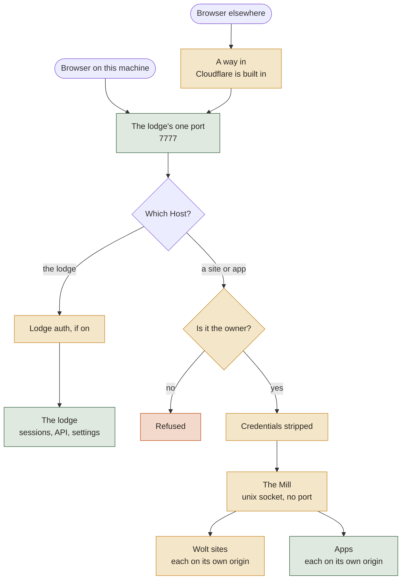
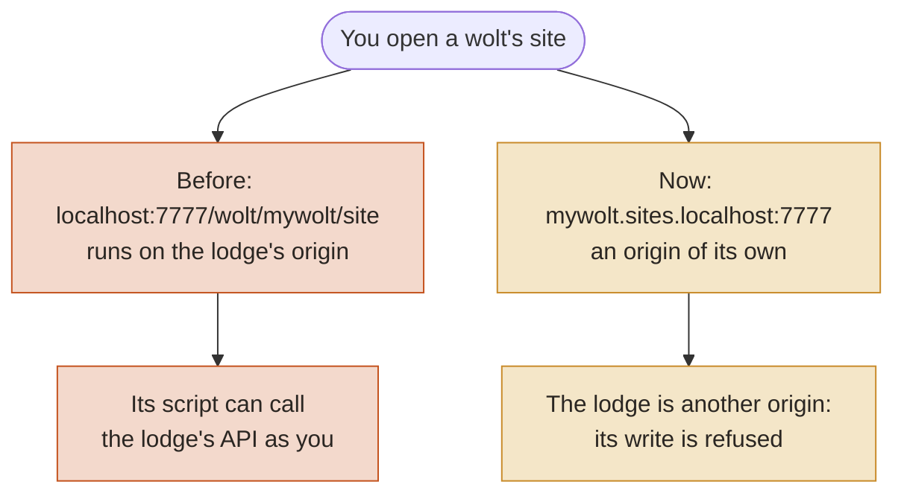
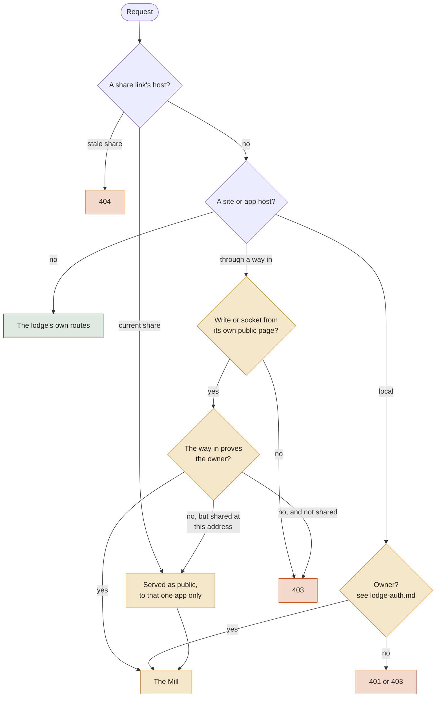
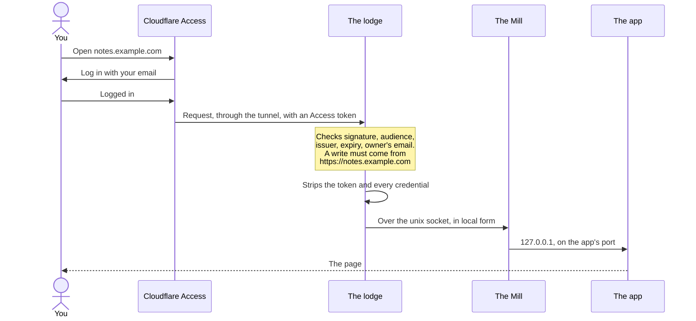
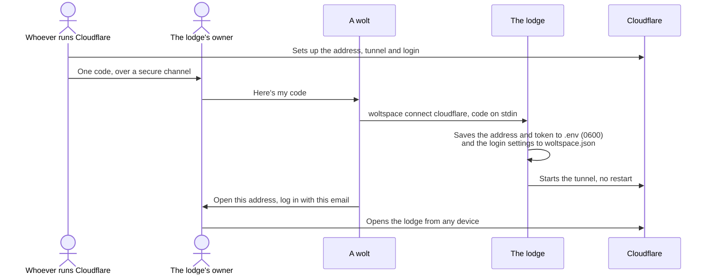
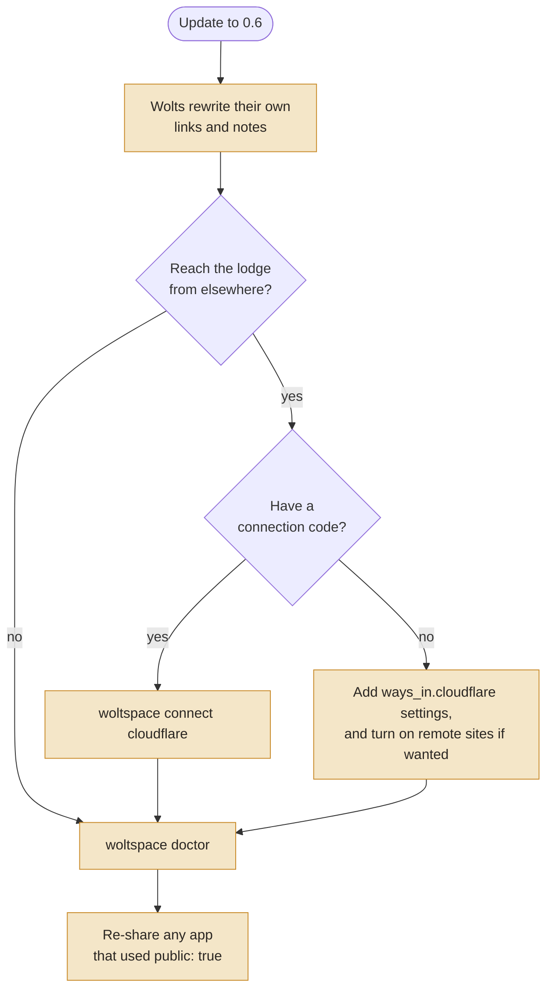

# Woltspace 0.6: how it fits together

0.6 does two things. A page or app a wolt wrote can't act as you, and a lodge can live at an address of its own, reachable from anywhere with your login.

This page is the map. Each piece has its own page for the details.

Colours in the diagrams: green was already there, amber is new in 0.6, red is refused or unsafe.

## The big picture

Everything comes in on the lodge's one port. The `Host` of a request decides where it goes: the lodge's own routes, or a site or app through the Mill.

## The pieces

| Piece | What it does | Default | Code | More |
|---|---|---|---|---|
| **The Mill** | Serves sites and apps, each on its own origin | On | `server/mill.py`, `server/content_hosts.py` | [mill.md](mill.md) |
| **Ways in** | Say who a visitor from elsewhere is. Cloudflare is one plugin among possible others | Cloudflare built in, unused until configured | `server/ways_in.py`, `server/access.py` | [ways-in.md](ways-in.md) |
| **Credential stripping** | The lodge's and Access's credentials never reach an app | On | `server/app_proxy.py` | [mill.md](mill.md#apps) |
| **One-code connect** | Applies a code and brings the tunnel up, with no restart | Run on demand | `src/woltspace/connect_cloudflare.py`, `server/tunnel.py` | [Cloudflare skill](../container/skills/cloudflare/connect.md) |
| **Explicit sharing** | Shares one app with anyone who has its link | Nothing shared | `container/lib/app_sharing.py` | [mill.md](mill.md#sharing-an-app) |
| **Lodge auth** | Keys for programs, pairing for browsers | Off | `container/lib/lodge_auth.py` | [lodge-auth.md](lodge-auth.md) |

## Why sites moved

Before 0.6, a wolt's site ran on the lodge's own origin. A wolt that read a hostile page could be talked into writing script into its site, and that script ran with your login.

The addresses:

| | On this machine | Through a way in (Cloudflare) |
|---|---|---|
| The lodge | `localhost:7777` | `lodge.example.com` |
| An app | `notes.localhost:7777` | `notes.example.com` |
| A wolt's site | `mywolt.sites.localhost:7777` | `site-mywolt.example.com`, once turned on |
| Old `/wolt/mywolt/site/...` and `/app/notes/...` | Redirect | Redirect |

## Which way a request goes

The order the lodge checks, in `MillForwardMiddleware`. Anything that isn't a site or app host falls through to the lodge.

## Opening an app from anywhere

Your login happens at Cloudflare, and the lodge checks the result again itself. The app never sees your token.

## Connecting a lodge with one code

Whoever runs Cloudflare for the domain does their part once and hands over one code. The lodge's owner never needs a Cloudflare account or API token.

The code holds a secret tunnel token. It never goes on a command line, in output or in a log, but a code pasted to a wolt does land in that session's transcript. The owner can run the command in their own terminal instead.

"Connected" means the tunnel process started, not that Cloudflare accepted the token. Opening the address and logging in is the real check.

## Upgrading

0.6 needs a hand, so it ships with a [migration guide](../container/migrations/v0.6.0.md) that a wolt walks through with you.

## What 0.6 doesn't do

- **Contain code running as you.** A wolt's tools or an app can still read your lodge's files and reach the Mill's socket. 0.6 protects your browser from a wolt's pages.
- **Separate Cloudflare entirely.** The lodge and the Mill go through the way-in interface, but the built-in plugin always loads, and sharing an app's link uses its own quick tunnel.
- **Check who holds an app's port.** The Mill reaches an app by the port the lodge recorded.
- **Keep a lodge-wide log.** That's still ahead.
