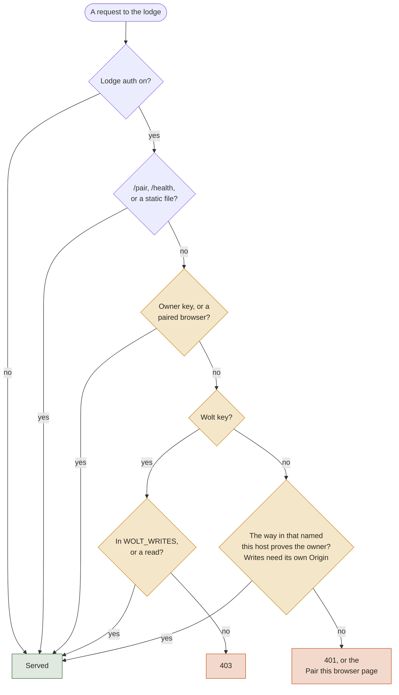
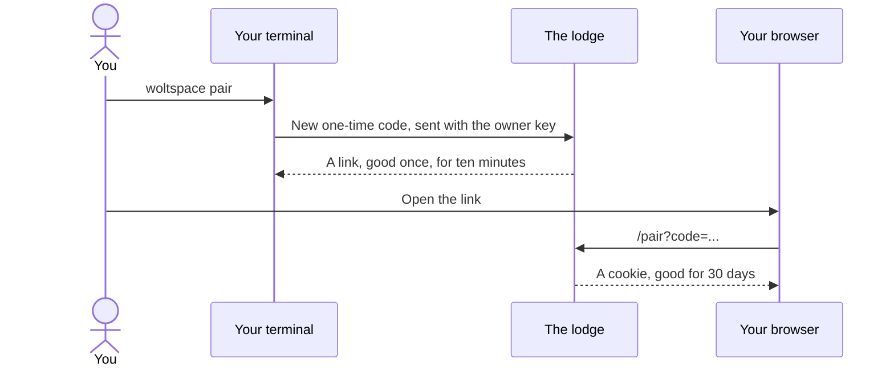
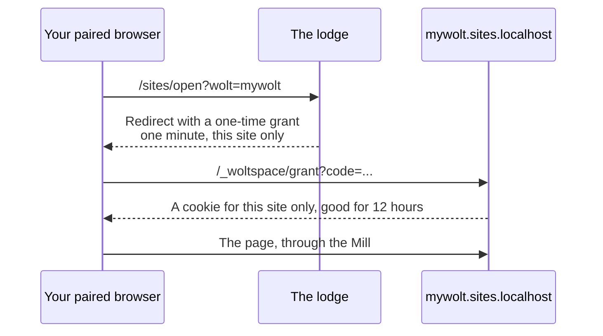

# Lodge auth

Lodge auth answers one question: being able to reach the lodge's port doesn't prove you're the owner, so what does?

With it **off**, anything that gets through to the port is treated as the owner. With it **on**, every request to the lodge needs proof. It's off by default. Turn it on with `WOLTSPACE_LODGE_AUTH=1` in the lodge's environment.

## What it changes

| Who's trying | Lodge auth off | Lodge auth on |
|---|---|---|
| A web page writing to the lodge across sites | Refused | Refused |
| A web page using DNS rebinding | Refused (the `Host` check) | Refused |
| A wolt's site or an app, in your browser | Its write is refused, as another origin | Refused |
| Another user on the machine | Acts as you | Refused: the keys are `0600` |
| A wolt's tools | Everything you can do | Reads, and only the writes in `WOLT_WRITES`: no lodge settings, no auto mode. It may share an app, when asked; every share is logged |
| A program running as you | Acts as you | **Can read the keys, so still acts as you** |
| A browser elsewhere, through Cloudflare | Stopped by Access alone | Stopped by Access, then checked again by the lodge |

The first three don't depend on lodge auth. They come from the origin checks on every request and from the Mill. So lodge auth is about **other programs on the machine and how much a wolt's tools may do**, and it adds a second check behind a way in. It's not a sandbox: see the "running as you" row.

## Who gets in

WebSockets (terminals, reload) are the owner's only, so a wolt's key can't open one. A socket opened with a way in's login closes when that login ends.

## The ways to prove it

| Proof | Who uses it | Where it comes from | Lasts |
|---|---|---|---|
| **Owner key** | Your terminal, the lodge itself | `<data root>/.space/run/lodge/owner.key` | Until replaced |
| **Wolt key** | Tools inside a wolt session | `<data root>/.space/run/lodge/wolt.key` | Until replaced |
| **Paired browser** | Your browser on any device | `woltspace pair`, in your own terminal (in a container: `docker exec <container> woltspace pair`) | 30 days |
| **A way in's login** | Your browser elsewhere | Your email, at Cloudflare Access | Until the login ends |

These files are machine-local. They never sync and never go in a backup. Only hashes of pairing codes and browser tokens are stored.

### Pairing a browser

`woltspace pair --forget` unpairs every browser and closes every site session.

### Opening a site with lodge auth on

A site has its own origin, so the lodge's cookie never reaches it. It gets its own, through a one-time grant:

Apps work the same way, and a site's grant never opens an app. With lodge auth off there's no grant: the lodge opens a local site or app for a visitor on this machine who came straight in.

## Through a way in

With lodge auth on, your login through a way in opens the lodge, so a phone doesn't need pairing. It works only on that way's own lodge host, and a login is something a browser sends by itself, so a write or socket must also carry `Origin` exactly `https://<the lodge's host>`.

**One limit:** with two Access applications, the lodge's token has a different audience from `apps_aud`. It isn't accepted, and that browser pairs instead.

## What to watch for

- **Containers need it for sites.** With lodge auth off, a local site or app opens only for a loopback caller, and a browser's connection into a container doesn't come from the container's loopback. So a container lodge's sites and apps answer `403` unless lodge auth is on or you reach them through a way in.
- **Raw `curl` to the lodge gets `401`.** The `woltspace` CLI and a wolt's tools send their key for you.
- **Turning it on needs a pairing,** or a login through a way in, before your browser can open the lodge again.
