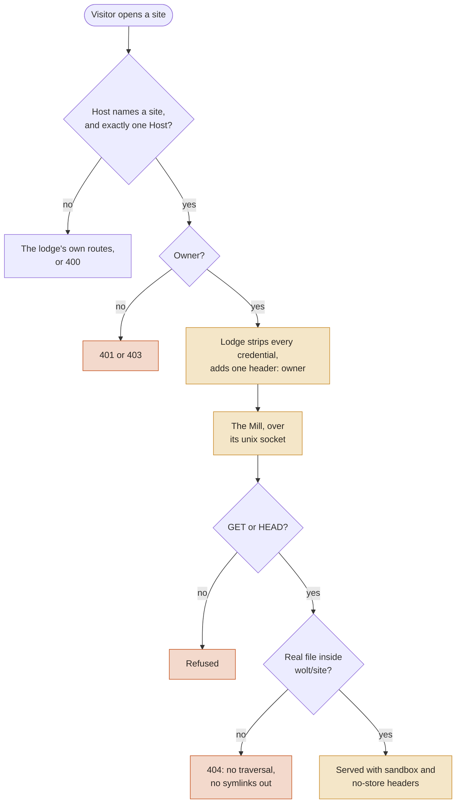
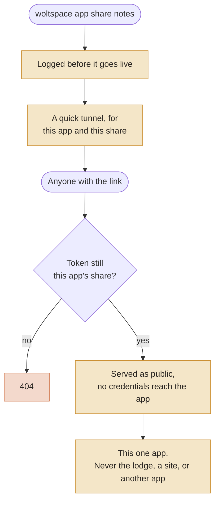

# The Mill

The Mill serves wolt sites and apps, each on an origin of its own, so a page a wolt wrote never runs with the lodge's origin. On the lodge's origin, its script could call the lodge's API as the owner.

## How a site is reached

- **The address:** `http://<wolt>.sites.localhost:7777/`, on the lodge's one port. Browsers resolve `*.localhost` to this machine with no DNS setup.
- **The forwarding:** the lodge recognises a site host and forwards it to the Mill. It never runs a lodge route for it.
- **The Mill itself:** its own process, supervised like the other connectors. It listens only on a unix socket, `<data root>/.space/run/mill/mill.sock`. The socket itself is `0666`, as uvicorn makes it; its folder is the owner's alone (`0700`), and that's what keeps other users out. It has no TCP port.
- **If the Mill is down:** sites answer `502` and the lodge keeps working.

A page's link to its own site's old address (`/wolt/<name>/site/<page>`) redirects to `/<page>` on the site.

The old addresses redirect: `/wolt/<name>/site/...` goes to `/sites/open`, and `/app/<name>/...` goes to `/apps/open`. The lodge never serves a wolt's pages on its own origin. Inside one of the lodge's own frames, with lodge auth on, the old site address shows an "open it" link instead. The lodge's sparks (`/history/...`) and tool pages (`/tools/...`) run in an opaque sandbox.

## Through the tunnel

`https://<app>.<your domain>/` and `https://site-<wolt>.<your domain>/` go through the lodge's port to the Mill. That needs `ways_in.cloudflare` settings in `woltspace.json` (see `container/migrations/v0.6.0.md`); without them nothing through the tunnel opens. The lodge first checks the Cloudflare Access token: signature, audience (the apps' Access application), issuer and expiry, for the owner's email. The token never goes further. A write or WebSocket must come from the content's own public page (`Origin: https://<its host>`; a write without an Origin is refused too), checked before the request is rewritten to its local form.

**Remote sites are off until you turn them on:** `"mill": {"remote_sites": true}` in `woltspace.json`. `site-<wolt>.<your domain>` may once have been an app's address, and that app's storage and service workers outlive it in visitors' browsers. Turn remote sites on only once you know no app ever used a `site-` name. An app named `site-…` is no longer served at all (the prefix is reserved; `woltspace doctor` names it), and while it exists the matching remote site stays off. `site-` is reserved for sites, so no app can take that name.

From the lodge reached through the tunnel, `/sites/open` and `/apps/open` send the browser to those public addresses.

Cloudflare's rule still points everything at the lodge's port. Pointing site and app hosts straight at the Mill's socket (`unix:`) waits until the Mill checks Access tokens itself.

**The trust limit:** the socket's folder keeps other users of the machine out. A program running as the owner (a wolt's tools, an app) can still connect to it and claim to be the owner. The Mill protects the owner's browser from a wolt's pages; it does not contain code running as the owner.

## Who may see a site

For now, only the owner. The lodge decides, and tells the Mill in one header after stripping any copy the visitor sent:

- **Lodge auth off** (the default): a visitor on this machine who came straight in, not through a tunnel. That's stricter than the old site address, which served anyone who reached the lodge. In a container lodge the browser's connection doesn't come from the container's loopback, so local sites and apps answer `403` there unless lodge auth is on (see `docs/lodge-auth.md`). The old addresses redirect to the same place.
- **Lodge auth on** (`WOLTSPACE_LODGE_AUTH=1`): a site has its own origin, so the lodge's cookie never reaches it.
  1. Open the site from the lodge, at `/sites/open?wolt=<name>&path=/page.html`. This needs the paired browser or the owner key.
  2. The lodge hands over a one-time grant, good for one minute and for that site only.
  3. The site's host turns the grant into a cookie of its own, valid for 12 hours.
  4. `woltspace pair --forget` closes those site sessions too.

The Mill forwards only content-negotiation, caching, range and browser-provenance headers. No cookie, `Authorization` or lodge key ever reaches it.

## A visit, step by step

Apps and sites get the same checks, in the same order, before any file is opened.

## What a site can do

- **Requests:** `GET` and `HEAD`, for files under the wolt's real `wolt/site/` folder. A symlinked site folder, symlinked files leading outside it, `..` and encoded separators all answer `404`.
- **Response headers:** every response carries `nosniff`, a sandbox that keeps the site's own origin and lets ordinary pages use forms, new tabs, dialogs and downloads (`sandbox allow-scripts allow-same-origin allow-forms allow-popups allow-modals allow-downloads`), and `Cache-Control: private, no-store`. So a revoked session leaves nothing cached, and a browser refetches each file.
- **Service workers:** refused.
- **Live reload:** owner pages get a reload client. Its socket, `/_woltspace/livereload`, only accepts the site's own origin.

## Apps

`http://<app>.localhost:7777/` goes through the Mill too. Apps reached through the tunnel go through the Mill too (see above).

- **Running apps:** the Mill proxies to the app's process on `127.0.0.1`, both ways streamed. That covers HTTP, uploads, server-sent events and WebSockets with their subprotocol. The app's own cookies and `Authorization` pass through. The lodge's and Access's credentials never do.
- **Static apps** (no `start` command): the Mill serves the app's real `dist/` folder if there is one, else its folder, with the site policy headers. Nothing whose real path has a dot-named part (`.git`, `.env`) is served, even through a symlink.
- **Who:** the owner only, decided the same way as for sites. With lodge auth on, an app opens in its own tab from `/apps/open?app=<name>`, and a site's grant never opens an app (or the reverse). The lodge's split view can't show it in a frame: the app's cookie isn't sent to a cross-site frame over http.
- **WebSockets** need an `Origin` naming the app itself, so a native client without one is refused. The app sees `Host: 127.0.0.1:<port>` on a WebSocket and `localhost:<port>` on HTTP.
- **Writes:** a browser write must come from the app's own page.
- **Ports:** an app gets `PORT`, its manifest's port, and `HOST=127.0.0.1`. A command that passes `--host $HOST` stays on loopback. One that binds `0.0.0.0` itself is still reachable on the network.
- **The port limit:** the Mill reaches an app by the port the lodge recorded, without checking which process holds it. Making sure the app's own process owns that port is a later step.

## Sharing an app

An app can be shared with anyone who has its link: an explicit choice, one app at a time (`container/lib/app_sharing.py`). The human makes it, and a wolt may carry it out when asked (the apps skill says so).

- **Commands:** `woltspace app share <app>`, `woltspace app unshare <app>`, `woltspace app unshare-all`, or `POST /apps/<app>/share`, `/unshare` and `/apps/unshare-all`. Starting an app never shares it, and `"public"` in a manifest does nothing.
- **The link, with no domain:** a quick tunnel for that one app, `cloudflared tunnel --url http://localhost:<lodge port> --http-host-header <app>--<token>.share.localhost:<lodge port>`, with a fresh random token per share. The lodge serves that host only as `public`, only to that app, and only while the token is the app's current share. A tunnel that outlives its share reaches nothing, even after the app is shared again. Its `trycloudflare.com` address changes when the tunnel restarts; the lodge restarts it at boot.
- **The link, with the lodge's domain:** `https://<app>.<domain>/` also opens without the owner's Access token, once the owner's Access policy lets visitors through for that host. The lodge can't change Access.
- **The visitor:** the lodge tells the Mill `public`, never `owner`, and the Mill checks the share record too. The visitor's request is filtered like the owner's: no lodge or Access credentials reach the app. A write or WebSocket must carry an `Origin` exactly equal to the app's public page; a missing, local-form or cross-site one is refused.
- **Never shared:** the lodge itself, wolt sites, and every other app. `<app>.localhost` stays the owner's only.
- **Record and log:** `<data root>/.space/run/sharing/shared.json` (private) is what's live. Every share writes `share-requested` to `<data root>/.space/logs/sharing.log` (0600, synced) before it goes live, then `shared`; boot writes `live-at-boot` for each live share. Unsharing takes effect first and is logged after. `woltspace app list` and `woltspace doctor` (`shared-apps`) show every shared app.
- **Cleanup:** an unshared tunnel stays listed as retired until it's confirmed stopped, and `doctor` fails while one runs. At boot the lodge also stops any of its share tunnels whose token is no current share (left by a crash). An unreadable `shared.json` is kept aside as `shared.json.corrupt-<time>` and every app is private until shared again.
- **After unsharing,** new requests are refused at once. A response already streaming may finish; open WebSockets close at their next 30 s check.

## Naming

How a site host is spelled depends on the way in, so naming is a list (`server/content_hosts.py`). Remote ways in (Cloudflare today) are plugins with their own names and owner check: see `docs/ways-in.md`. The local schemes are `<wolt>.sites.localhost` and `<app>.localhost`. Remote ways in add theirs when they start serving sites. A site label is a DNS label, so a wolt whose name has `_` or is over 63 characters has no site host (`woltspace doctor` names it). Sites share the parent `sites.localhost`, so a site's page can set a cookie that other sites receive. Sites are read-only and their session cookies are tied to one site, so at worst this logs a site's visitor out with lodge auth on.
