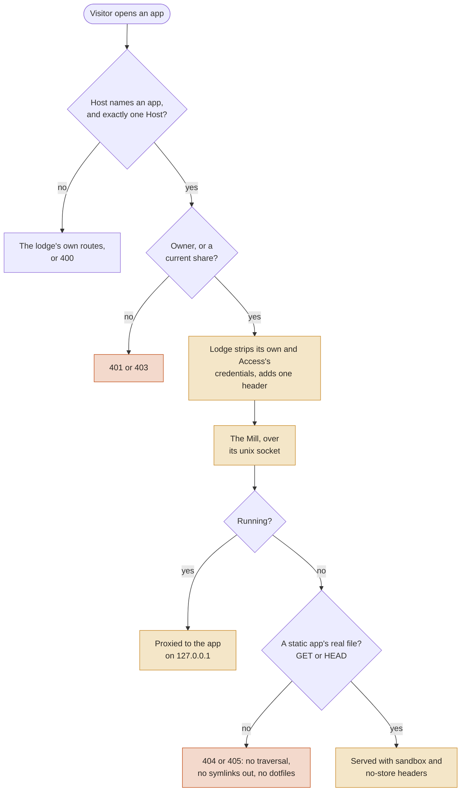
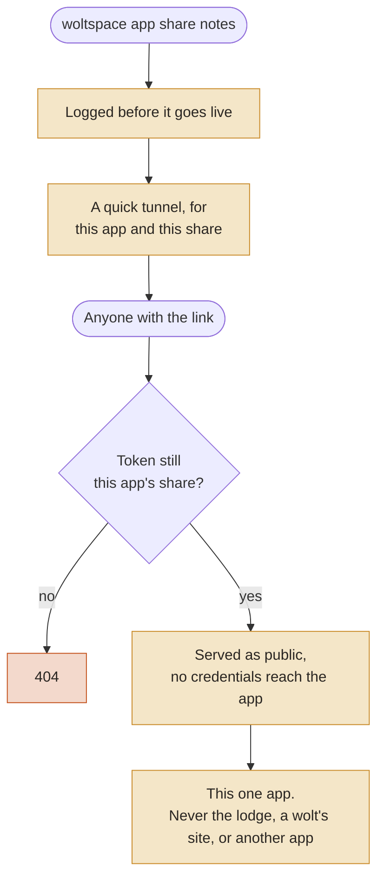

# The Mill

The Mill serves apps, each on an origin of its own, so an app's page never runs with the lodge's origin. On the lodge's origin, its script could call the lodge's API as the owner.

Wolt sites aren't in the Mill in 0.6. They stay where they were, at `/wolt/<name>/site/` on the lodge, with the nav shell, the About page for a site with no `index.html`, and live reload. A site is a lodge page: with lodge auth on it needs a paired browser like any other, and through the tunnel it opens on the lodge's own address. Giving sites an origin of their own is a later change.

## How an app is reached

- **The address:** `http://<app>.localhost:7777/`, on the lodge's one port. Browsers resolve `*.localhost` to this machine with no DNS setup.
- **The forwarding:** the lodge recognises an app host and forwards it to the Mill. It never runs a lodge route for it.
- **The Mill itself:** its own process, supervised like the other connectors. It listens only on a unix socket, `<data root>/.space/run/mill/mill.sock`. The socket itself is `0666`, as uvicorn makes it; its folder is the owner's alone (`0700`), and that's what keeps other users out. It has no TCP port.
- **If the Mill is down:** apps answer `502` and the lodge keeps working.

The old address `/app/<name>/...` redirects to `/apps/open`. Inside one of the lodge's own frames, with lodge auth on, it shows an "open it" link instead. The lodge's sparks (`/history/...`) and tool pages (`/tools/...`) run in an opaque sandbox.

## Through the tunnel

`https://<app>.<your domain>/` goes through the lodge's port to the Mill. That needs `ways_in.cloudflare` settings in `woltspace.json` (see `container/migrations/v0.6.0.md`); without them no app opens through the tunnel. The lodge first checks the Cloudflare Access token: signature, audience (the apps' Access application), issuer and expiry, for the owner's email. The token never goes further. A write or WebSocket must come from the app's own public page (`Origin: https://<its host>`; a write without an Origin is refused too), checked before the request is rewritten to its local form.

An app named `site-…` isn't served, locally or through the tunnel (`woltspace doctor` names it): the prefix stays reserved, so no app takes a name a wolt's site may need later. An app's name is a host label, so the Mill opens and sharing shares the same names: lowercase letters, digits and dashes, no dash at either end (`container/lib/app_names.py`).

From the lodge reached through the tunnel, `/apps/open` sends the browser to the app's public address.

Cloudflare's rule still points everything at the lodge's port. Pointing app hosts straight at the Mill's socket (`unix:`) waits until the Mill checks Access tokens itself.

**The trust limit:** the socket's folder keeps other users of the machine out. A program running as the owner (a wolt's tools, an app) can still connect to it and claim to be the owner. The Mill protects the owner's browser from an app's pages; it does not contain code running as the owner.

## Who may open an app

The owner, or anyone with the link of an app the owner shared (below). The lodge decides, and tells the Mill in one header after stripping any copy the visitor sent:

- **Lodge auth off** (the default): a visitor on this machine who came straight in, not through a tunnel. In a container lodge the browser's connection doesn't come from the container's loopback, so local apps answer `403` there unless lodge auth is on (see `docs/lodge-auth.md`).
- **Lodge auth on** (`WOLTSPACE_LODGE_AUTH=1`): an app has its own origin, so the lodge's cookie never reaches it.
  1. Open the app from the lodge, at `/apps/open?app=<name>&path=/page`. This needs the paired browser or the owner key.
  2. The lodge hands over a one-time grant, good for one minute and for that app only.
  3. The app's host turns the grant into a cookie of its own, valid for 12 hours.
  4. `woltspace pair --forget` closes those app sessions too.

## A visit, step by step

## What an app gets

- **Running apps:** the Mill proxies to the app's process on `127.0.0.1`, both ways streamed. That covers HTTP, uploads, server-sent events and WebSockets with their subprotocol. The app's own cookies and `Authorization` pass through. The lodge's and Access's credentials never do.
- **Static apps** (no `start` command): the Mill serves the app's real `dist/` folder if there is one, else its folder, `GET` and `HEAD` only. A symlinked root, symlinked files leading outside it, `..`, encoded separators and anything whose real path has a dot-named part (`.git`, `.env`) answer `404`. Every file carries `nosniff`, a sandbox that keeps the app's own origin and lets ordinary pages use forms, new tabs, dialogs and downloads (`sandbox allow-scripts allow-same-origin allow-forms allow-popups allow-modals allow-downloads`), and `Cache-Control: private, no-store`, so a revoked share leaves nothing cached.
- **In the lodge's frames:** with lodge auth on, an app opens in its own tab from `/apps/open?app=<name>`. The lodge's split view can't show it in a frame: the app's cookie isn't sent to a cross-site frame over http.
- **WebSockets** need an `Origin` naming the app itself, so a native client without one is refused. The app sees `Host: 127.0.0.1:<port>` on a WebSocket and `localhost:<port>` on HTTP.
- **Writes:** a browser write must come from the app's own page.
- **Ports:** an app gets `PORT`, its manifest's port, and `HOST=127.0.0.1`. A command that passes `--host $HOST` stays on loopback. One that binds `0.0.0.0` itself is still reachable on the network.
- **The port limit:** the Mill reaches an app by the port the lodge recorded, without checking which process holds it. Making sure the app's own process owns that port is a later step.

## Sharing an app

An app can be shared with anyone who has its link: an explicit choice, one app at a time (`container/lib/app_sharing.py`). The human makes it, and a wolt may carry it out when asked (the apps skill says so).

- **Commands:** `woltspace app share <app>`, `woltspace app unshare <app>`, `woltspace app unshare-all`, or `POST /apps/<app>/share`, `/unshare` and `/apps/unshare-all`. Starting an app never shares it, and `"public"` in a manifest does nothing.
- **The link, with no domain:** a quick tunnel for that one app, `cloudflared tunnel --url http://localhost:<lodge port> --http-host-header <app>--<token>.share.localhost:<lodge port>`, with a fresh random token per share. The lodge serves that host only as `public`, only to that app, and only while the token is the app's current share. A tunnel that outlives its share reaches nothing, even after the app is shared again. Its `trycloudflare.com` address changes when the tunnel restarts; the lodge restarts it at boot.
- **The link, with the lodge's domain:** `https://<app>.<domain>/` also opens without the owner's Access token, once the owner's Access policy lets visitors through for that host. The lodge can't change Access.
- **The visitor:** the lodge tells the Mill `public`, never `owner`, and the Mill checks the share record too. The visitor's request is filtered like the owner's: no lodge or Access credentials reach the app. A write or WebSocket must carry an `Origin` exactly equal to the app's public page; a missing, local-form or cross-site one is refused.
- **Never shared:** the lodge itself, wolt sites, and every other app. `<app>.localhost` stays the owner's only.
- **Record and log:** `<data root>/.space/run/sharing/shared.json` (private) is what's live. Every share writes `share-requested` to `<data root>/.space/logs/sharing.log` (0600, synced) before it goes live, then `shared`; boot writes `live-at-boot` for each live share. Unsharing takes effect first and is logged after. `woltspace app list` and `woltspace doctor` (`shared-apps`) show every shared app.
- **Cleanup:** an unshared tunnel stays listed as retired until it's confirmed stopped, and `doctor` fails while one runs. At boot the lodge also stops any of its share tunnels whose token is no current share (left by a crash). An unreadable `shared.json` is kept aside as `shared.json.corrupt-<time>` and every app is private until shared again.
- **After unsharing,** new requests are refused at once. A response already streaming may finish; open WebSockets close at their next 30 s check.

## Naming

How an app host is spelled depends on the way in, so naming is a list (`server/content_hosts.py`). Locally it's `<app>.localhost`. Remote ways in (Cloudflare today) are plugins with their own names and owner check: see `docs/ways-in.md`.
