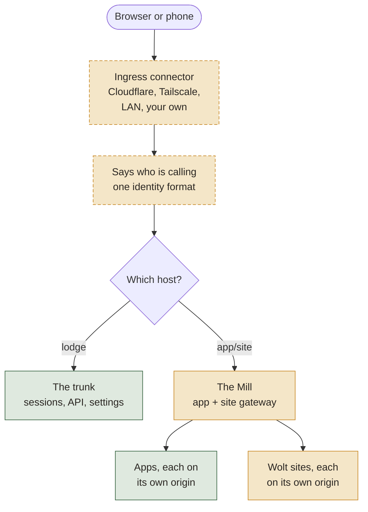
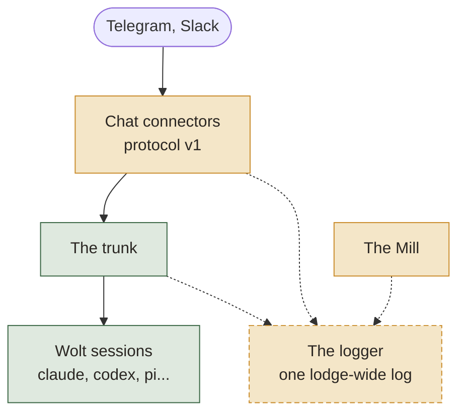
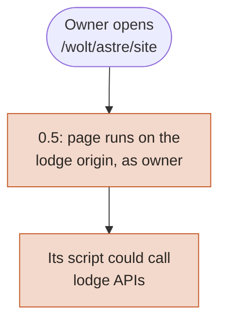
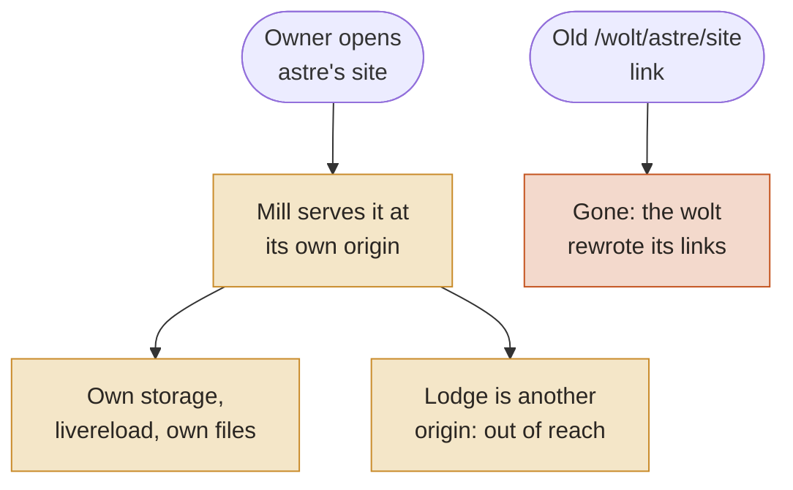
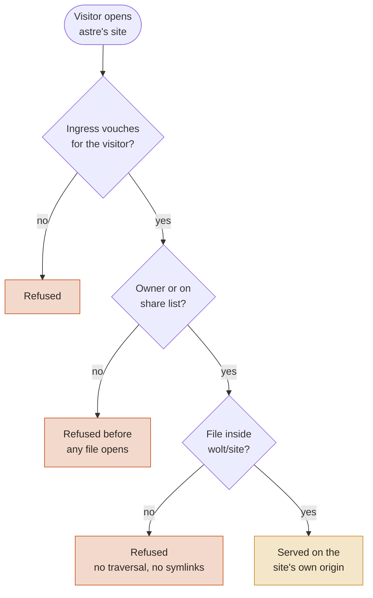
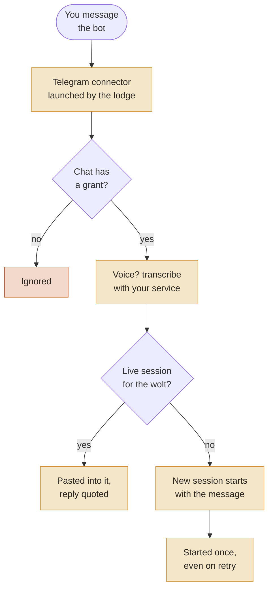
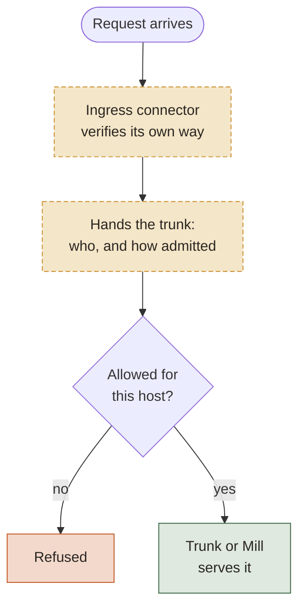
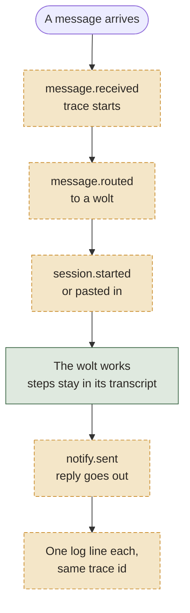
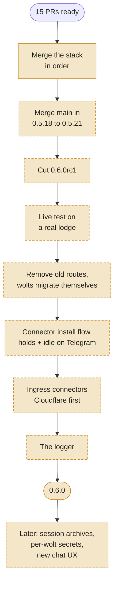

# RFC: Woltspace 0.6

**Status:** request for comments. Nothing here is final until this file is merged.
**Scope:** what 0.6 is for, what is already built, what is proposed, and the open questions.

## Summary

0.6 rests on three pillars:

1. **Safe by default.** A wolt's page can never act as you, and an app never takes a port it doesn't own.
2. **Everything is a connector.** Chat apps and ways into the lodge plug in through one protocol each. The core doesn't know which vendor carried a message or a request.
3. **Observable, then reproducible.** One lodge-wide log records what happened, end to end. It's the first step toward replaying how a result was reached.

0.6 breaks things on purpose and keeps no compatibility layers. Each wolt migrates its own old stuff on upgrade, following the migration guide `container/migrations/v0.6.0.md`, which lists every break.

## What a user notices

Almost nothing. 0.6 is mostly under the hood: the same lodge, the same wolts, the same chat. The visible changes are small:

- A wolt's site opens at its own address instead of a path on the lodge.
- Telegram keeps working as before, now through its connector. An existing setup carries over by itself.
- The Telegram dog is gone.
- After the upgrade, each wolt fixes its own links and notes, and the owner gets a short report.

## Names

| Name | What it is |
|---|---|
| **The trunk** | The core: sessions, the lodge API, settings, routing. |
| **The Mill** | The gateway for apps and wolt sites, each on its own origin. |
| **Connectors** | Separate processes that bring things in and out: chat (Telegram, Slack) and ingress (Cloudflare, Tailscale, LAN). |
| **The logger** | One append-only log for the whole lodge. |

## The big picture

Colours: green is there in 0.5, solid amber is new in 0.6 and built, dashed amber is proposed, red is refused.

## Pillar 1: safe by default (built)

### Wolt sites move off the lodge origin

In 0.5 a wolt's site is served on the lodge's own origin. A wolt that read a hostile web page could write script into its site, and that script would run with your lodge login.

In 0.6 a site lives only at its own origin, served by the Mill: `astre.sites.localhost` on your machine, `site-astre.<apps domain>` remotely. The old `/wolt/astre/site` route is removed, with no redirect and no fallback copy.

### A visit through the Mill

Apps and sites get the same checks, in the same order, before any file is opened.

| PR | What it does |
|---|---|
| #539 | Lodge hardening: lodge pages can't be framed by others, requests with no origin are refused, a wolt can't shadow the lodge's service worker (to rework: drop its old-route parts) |
| #540 | Serve wolt sites through the Mill on their own origin (gateway side) |
| #543 | Lodge side: the wolt page, the split view and push-view open each site at its own origin (to rework: drop the old-route parts) |
| #545 | Apps never start on a port another program already holds |

## Pillar 2: everything is a connector

### Chat (built)

Telegram is rebuilt on connector protocol v1 and becomes the default. An existing Telegram setup is adopted on first start.

| PR | What it does |
|---|---|
| #546 | Connector protocol v1: core state, local API, a fake connector for tests |
| #547 | Telegram on the connector protocol |
| #548 | The lodge launches the Telegram connector |
| #549 | Telegram chat commands with per-chat grants |
| #550 | Voice transcription for connector events |
| #560 | A message starts a session; replies are quoted; `/apps` |
| #561 | Telegram runs on its connector by default; an adapter setup carries over |
| #566 | Configurable transcription service |

### Ingress (proposed)

Today the lodge checks Cloudflare Access tokens itself (#538, #562). Other ways in (a tailnet, a LAN) can only be listed as allowed hosts, without an identity of their own.

Proposal: a way in is a connector too. An ingress connector terminates the way in, verifies the caller its own way, and hands the trunk one identity record. The trunk and the Mill decide what that caller may reach. They never look at vendor tokens.

| Connector | How it verifies |
|---|---|
| Cloudflare (first) | Access token at the edge; today's #538 logic moves here |
| Tailscale | The tailnet's own idea of who is calling |
| LAN | A paired device |
| Local | The loopback caller is the owner, as today |

Cloudflare is the first one built, so #538 and #562 become its starting point.

## Pillar 3: observable, then reproducible (proposed)

### The logger

One append-only log for the lodge, `.space/logs/lodge/YYYY-MM-DD.jsonl`, written by every part: the trunk, the Mill, connectors, the CLI. Records follow the OpenTelemetry data model, so standard tools can read them. A trace id follows one request through every hop.

- Event names come from a fixed list, and each event has a fixed set of attributes. There is no free text except the message body.
- Message bodies are governed by one setting (see open questions). Known secrets are redacted before anything is written.
- It's for visibility first. A record can be dropped under load, and drops are counted.

### Session archives (after 0.6.0)

Every engine already writes its own transcript. The lodge copies each one as is, with a small manifest (wolt, session, engine, start and end), to a private store the owner chooses. Transcripts can hold secrets, so the archive is private and encrypted, or redacted before it leaves the lodge.

## The road to 0.6.0

Merge order: #562 into #538, then #538, #540, #539, #543, #545, #546, #547, #548, #549, #550, #560, #561, #566, and #527 (release notes and migration guide) last.

## Help wanted

- **#583:** pastes over about 16 KB into a session fail on tmux's own limit. Reading the text from stdin fixes it.
- **Boot context off the command line:** today it is visible in the process list.
- **Test hygiene:** some tests touch the real wolts folder or a live lodge.
- **`/holds` and `/idle` on the Telegram connector:** they exist only in the 0.5 adapter.

## Migration: wolts do it

There are no shims, redirects or deprecated routes in 0.6. On first boot after the upgrade, each wolt reads the migration guide and fixes its own files: site links, `push-view` paths, skills and notes that point at removed routes. The owner sees a short report of what each wolt changed.

## Open questions

1. **rc1 timing.** Cut rc1 now with what's built, and land ingress and the logger in later candidates? Or one candidate with everything?
2. **Logger bodies.** Off by default and asked at setup, or on by default?
3. **Logger format.** Is a plain JSONL file per day enough for v1, with no viewer yet?
4. **Ingress identity.** What goes in the identity record: a stable id, an email, the connector name, the way in?
5. **Slack.** Does Slack move onto the connector protocol in 0.6.0 or later?
6. **Connector install.** How does an owner add, update and remove a connector?
