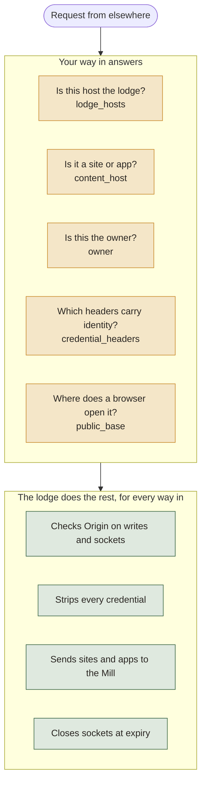

# Writing a way in

A **way in** is how a browser somewhere else reaches the lodge, its wolts' sites and its apps: a tunnel, a VPN, a proxy. Cloudflare is the built-in one. Anyone can add another (Tailscale, a self-hosted proxy, anything) as a small Python object, without changing the lodge or the Mill.

The code is `server/ways_in.py`. Its Cloudflare class, `CloudflareAccess`, is the worked example.

## What a way in answers

| | Method | Answers |
|---|---|---|
| 1 | `lodge_hosts()` | The names this way gives the **lodge itself** (`owner.example.com`). Requests to them go to the lodge's own routes. |
| 2 | `content_host(host)` | Whether a `Host` header names a **wolt's site or an app** through this way: a `PublicHost(kind, name, authority)`, or `None`. |
| 3 | `owner(headers, scope)` | Whether this request is **the owner**, proven this way's own way: a `Visitor("owner", expires_at)`, or `None` for anyone else. It opens the content this way serves, and the lodge at this way's `lodge_hosts()` when lodge auth is on. |
| 4 | `credential_headers` | The headers this way uses to say who the visitor is. They're **stripped before anything reaches an app**, on every request, whichever way it came. |
| 5 | `public_base(lodge_host, kind, name)` | Where a browser that reached the lodge at `lodge_host` through this way opens a site or app (for `/sites/open` and `/apps/open`), or `None`. |

The lodge does the rest the same way whichever way a request came:
- it sends sites and apps to the Mill;
- it strips the lodge's and Access's credentials and your `credential_headers`;
- it checks that a write or WebSocket carries an `Origin` exactly `https://<authority>`;
- it closes WebSockets at `expires_at`;
- it serves shared apps to anyone (`docs/mill.md`), and never shares the lodge or a site.



## Rules a way in must keep

- **Each site and app gets an authority of its own.** An origin is scheme, host and port, and two sites on one origin could read each other's storage and script. A subdomain each (`<app>.example.com`) is best. A port each on one host (`machine.example.ts.net:8443`) gives each its own origin, but **cookies ignore ports**: every app on that host sees, and can set, cookies for the others and the lodge. The lodge strips its own cookies before an app and keeps an app's `Set-Cookie` host-only, but apps' own cookies aren't isolated from each other. Say so to users of such a way in. A path each (`/apps/<app>/`) doesn't work.
- **`authority` is exactly what the browser sends**, host plus `:port` when it isn't 443. The lodge compares `Origin` against `https://<authority>`.
- **`owner()` fails closed.** Anything unexpected (a missing header, an error, a request that didn't come through your proxy) returns `None`. Return "owner" only for the owner's verified identity, never for "anyone signed in".
- **Trust only what your proxy sets, through a boundary that holds.** If your way in names the visitor in a header (as Tailscale Serve does with `Tailscale-User-Login`), anyone who can reach the lodge's port can send that header, including any other process on the machine. "From loopback" alone proves nothing. Use a boundary another local process can't cross:
  - ask the proxy itself who the connection is (Tailscale's LocalAPI `whois` on the peer address);
  - or have the proxy reach the lodge over something only it holds, such as a private unix socket or a secret it sends.

  This stays within the lodge's stated limit (code running as the owner can read the lodge's keys anyway), but it must not let other users on the machine, or apps, pass as the owner.
- **Gate the lodge's own hosts.** Requests to `lodge_hosts()` reach the lodge's routes. With lodge auth on, they need a key, a paired browser, or `owner()`. With lodge auth off, the way in itself must keep strangers out, as Cloudflare Access does in front of the lodge's tunnel host.
- **List every identity header in `credential_headers`.** The lodge drops them before an app sees a request, so an app can never be fooled by a forged one.
- **Don't claim another way's hosts.** The first way in whose `content_host` matches a host wins.
- **Keep your settings under your own name:** `"ways_in": {"<name>": {...}}` in `woltspace.json`, as Cloudflare does. Nothing outside your way in reads them.

## Connecting with a code

Cloudflare's way in can be set up from one code: `woltspace connect cloudflare` reads it from stdin and saves what it holds (`src/woltspace/connect_cloudflare.py`). It's a convenience of that way in, not part of the interface. Another way in can add its own choice to `woltspace connect`.

## Installing one

A way in ships as a Python package with an entry point in the `woltspace.ways_in` group:

```toml
# pyproject.toml of your package
[project.entry-points."woltspace.ways_in"]
tailscale = "woltspace_tailscale:TailscaleServe"
```

The entry point is an object with the methods above, or a class or function that returns one. Install the package into the lodge's environment (for a `uv tool` install: `uv tool install woltspace --with woltspace-tailscale`) and restart the lodge. Installing it is the opt-in. A plugin that fails to load is skipped and logged; it never stops the lodge.

In tests, `ways_in.register(way)` adds one directly. `test/test_mill_switchover.py` (`_TestNet`) has a complete made-up way in, with the tests every way in should pass:
- the owner opens an app;
- anyone else gets `403`;
- writes come from the public page only;
- the identity header never reaches an app, even forged locally;
- `/apps/open` sends the browser to the public address.

## Sketch: Tailscale

Tailscale gives a machine one name on the tailnet (`machine.tailnet.ts.net`) and no wildcard subdomains. So a Tailscale way in would give each site and app **its own HTTPS port** on that name, which is still an origin of its own:

- **Lodge:** `tailscale serve --https=443 http://localhost:7777` → `lodge_hosts()` is `{"machine.tailnet.ts.net"}`.
- **Each app or site:** `tailscale serve --https=<port> http://localhost:7777`, with the proxy sending `Host: machine.tailnet.ts.net:<port>`. `content_host` maps each port to its app or site, from a small table the plugin keeps.
- **Owner:** Tailscale Serve adds `Tailscale-User-Login` for tailnet users. Don't trust the header alone: confirm with tailscaled's LocalAPI `whois` that the connection really is that tailnet user, and accept only the owner's login.
- **Cookies:** with one host and a port each, apps share cookies across ports (see the rules above). Tell users, and prefer Tailscale Services or a domain of your own if you need full isolation.
- **`credential_headers`:** `tailscale-user-login`, `tailscale-user-name`, `tailscale-user-profile-pic`, `tailscale-app-capabilities`.
- **Shared apps:** sharing has its own way out (a quick tunnel per app, `docs/mill.md`). A way in's hosts stay owner-only for a shared app unless the share records that exact public address, as it does for the Cloudflare domain today. Opening shares through Tailscale Funnel would need the same.
